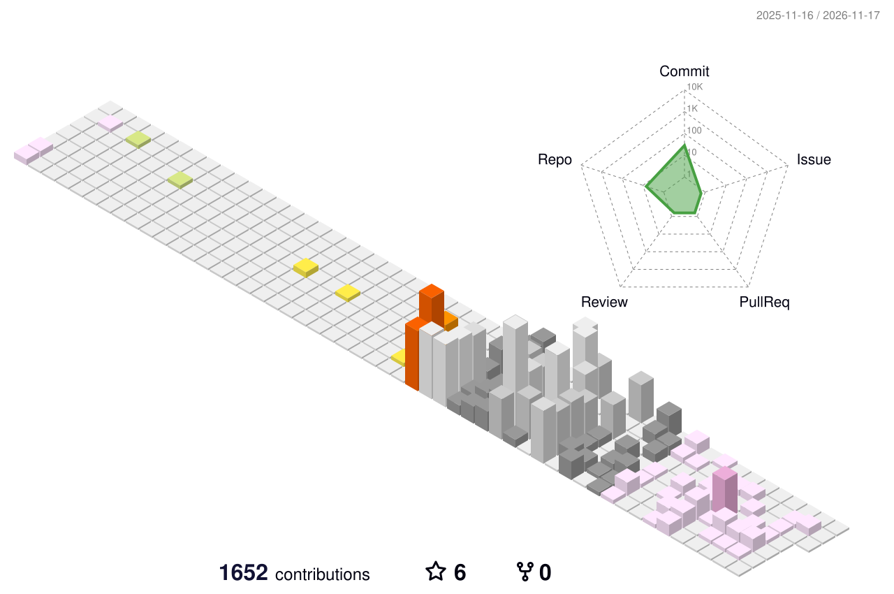

  

 

  

 

### GIS · WebGIS · Spatial Intelligence · AI Systems

Exploring geospatial platforms, spatial data engineering, and AI-assisted workflows.

 

### Nanjing Eye Footbridge

A 24-second film of the Nanjing Eye, reconstructed from site photographs and published dimensions. Follow the curved approach from Jiangxinzhou island to the bridge’s twin inclined towers.

https://github.com/user-attachments/assets/a38a4831-dbcc-4143-b502-69c701c8da79

[Explore the reconstruction workflow](https://github.com/Yxywindows/dsm-to-threejs) · [Download the 1080p film](https://github.com/Yxywindows/dsm-to-threejs/releases/download/v1.0.0/nanjing-eye-1080p.mp4)

