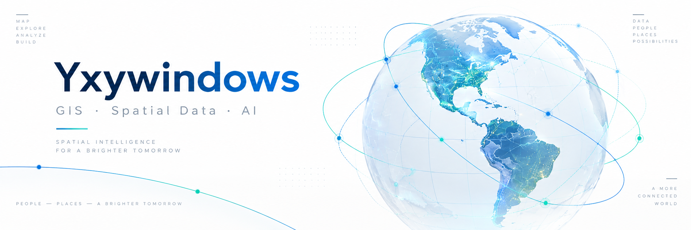

  

 

  

 

### GIS · WebGIS · Spatial Intelligence · AI Systems

Exploring geospatial platforms, spatial data engineering, and AI-assisted workflows.

 

### Nanjing Eye Footbridge

A 24-second film of the Nanjing Eye, reconstructed from site photographs and published dimensions. Follow the curved approach from Jiangxinzhou island to the bridge’s twin inclined towers.

[Explore the reconstruction workflow](https://github.com/Yxywindows/dsm-to-threejs)

